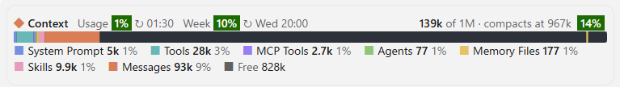

# claude-mods

Claude Code mods by Bao: a context-window bar with plan usage, and a subagents panel.



| Mod | What it does |
|---|---|
| [`context-bar`](#context-bar) | A colored context-window bar above the prompt, broken down by category, with plan usage badges and reset times. |
| [`agents-panel`](#agents-panel) | A pane listing your subagents, with a run button, live status and each run's report. |

## Install

Requires a Claude Code version that supports mods (developed on 2.1.310).

```
/plugin marketplace add baoxingx/claude-mods
/plugin install context-bar@baoxingx-mods
/plugin install agents-panel@baoxingx-mods
```

Then run `/reload-plugins` (or start a new session).

---

## context-bar

A box above the prompt that shows how the context window is filling up and how much of your plan you have used.

### Reading the bar

```
◆ Context   Usage [ 1% ] ↻ 01:30   Week [ 10% ] ↻ Wed 20:00        139k of 1M · compacts at 967k  [ 14% ]
████████▒▒▒▒▒▒░░░░░░░░░░░░░░░░░░░░░░░░░░░░░░░░░░░░░░░░░░░░░░░░░░░░░░░░░░░░░░░░░░░│░░░░
■ System Prompt 5k 1%  ■ Tools 28k 3%  ■ MCP Tools 2.7k 1%  ■ Agents 77 1%  ■ Memory Files 177 1%
■ Skills 9.9k 1%  ■ Messages 93k 9%  ■ Free 828k
```

| Part | Meaning |
|---|---|
| **Usage** | Plan usage of the 5-hour session window, and the local time it resets (`↻ 01:30`). |
| **Week** | Plan usage of the 7-day window (all models), and the local day and time it resets (`↻ Wed 20:00`). |
| **139k of 1M** | Tokens currently in context, out of the model's context window. |
| **compacts at 967k** | Where auto-compact kicks in; drawn as a yellow marker on the bar. Hidden when auto-compact is off. |
| **14%** badge | How full the context window is. |
| Bar segments | Tokens per category, in a fixed order and color: System Prompt, Tools, MCP Tools, Agents, Memory Files, Skills, Messages. Any other category the engine reports is shown in gray. |
| **Free** | Tokens left in the window. |

Badge colors, for all three percentages:

| Usage | Color |
|---|---|
| under 50% | green |
| 50% – 79% | yellow |
| 80% and over | red |

### Commands

| Command | Effect |
|---|---|
| `/context-bar` | Toggle the bar. |
| `/context-bar on` | Show it. |
| `/context-bar off` | Hide it. |

The on/off choice is remembered across sessions. The bar is off until you turn it on the first time.

### When it updates

- After each reply of the main conversation (not after subagent turns).
- After `/clear`, `/resume` and `/compact`.
- Whenever the plan usage figures change.

Until the first reply it shows `measuring…`.

### Notes

- **Usage** and **Week** appear only on a Claude Pro / Max subscription. With an API key there are no plan limits to report, so the badges are hidden.
- Reset times are shown as clock times in your local time zone, not as a countdown, because the bar only redraws when something changes.
- In the terminal the bar is drawn with block characters; in the Desktop app it is an SVG bar.

---

## agents-panel

A pane that lists the subagents you have defined and lets you run them with one click.

### Usage

Run `/agents-panel` to open the pane, and run it again (or close the pane) to hide it.

The pane lists agents from two places:

| Section | Folder |
|---|---|
| **PROJECT** | `.claude/agents/*.md` in the current project |
| **USER** | `~/.claude/agents/*.md` |

A project agent hides a user agent with the same name. Each row shows the agent's name, model (`inherit` when not set) and description, read from the file's frontmatter.

### Running an agent

- Click **▶ run** to start the agent.
- By default it gets a generic task: do its job on the current project, as its own instructions describe, and finish with a short report.
- To give it a specific task instead, type it in the **Task** box first. The task is used for the next run, then cleared.

### Status

| Status | Meaning |
|---|---|
| `◌ running · 12s` | Running, with elapsed time (ticks every second). |
| `✓ done · 1m 4s` | Finished, with how long it took. Click **report** to read its final answer, **hide** to fold it away. |
| `✕ stopped` | Failed, was aborted, or was killed. |

The header shows how many agents are running, or `idle`. Agents that Claude starts on its own also appear as running, as long as they are listed in the pane. When a run finishes you get a toast.

If no agents are found, the pane says so: ask Claude to create one (for example a code reviewer), then run `/agents-panel` again.

---

## Development

Each mod is a folder with `.claude-plugin/plugin.json`, `hooks/register.tsx` (the mod), `types/index.d.ts` and `tests/`.

To load a local copy instead of the installed one, point `CLAUDE_CODE_PLUGIN_DIRS` at the mod folders (separated by `;` on Windows, `:` elsewhere), for example in `~/.claude/settings.json`:

```json
{
  "env": {
    "CLAUDE_CODE_PLUGIN_DIRS": "/path/to/claude-mods/context-bar;/path/to/claude-mods/agents-panel"
  }
}
```

Run `/reload-plugins` after a change.

Tests:

```
claude plugin test context-bar
claude plugin test agents-panel
```

## License

[MIT](LICENSE)
